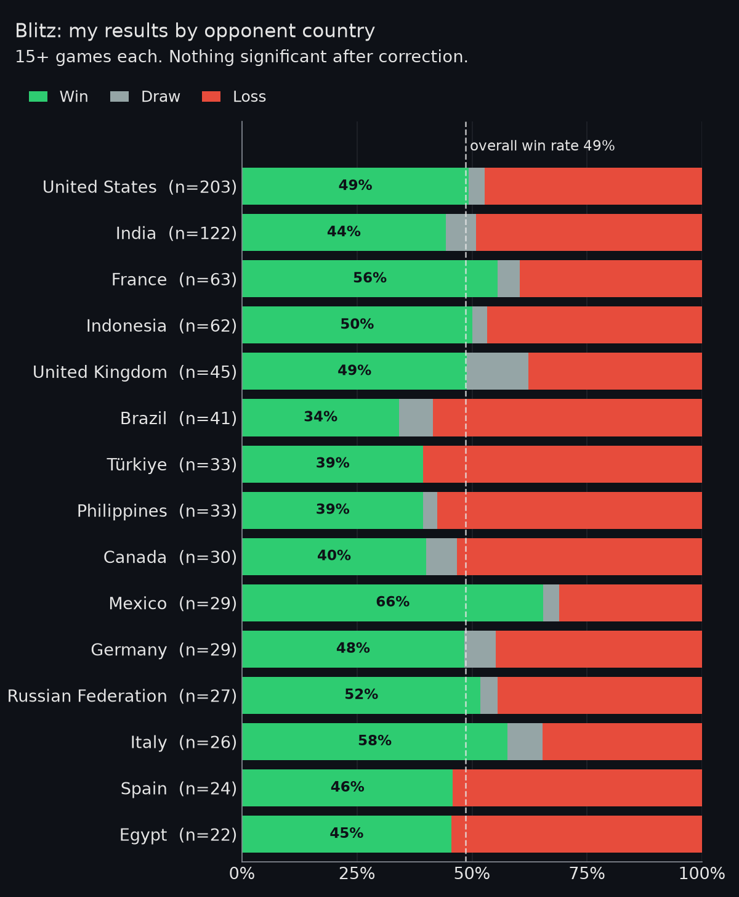
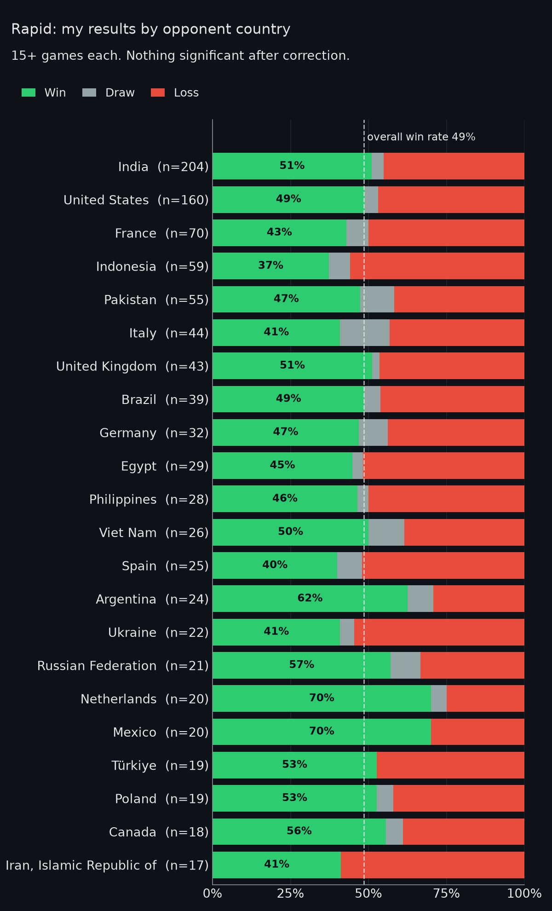
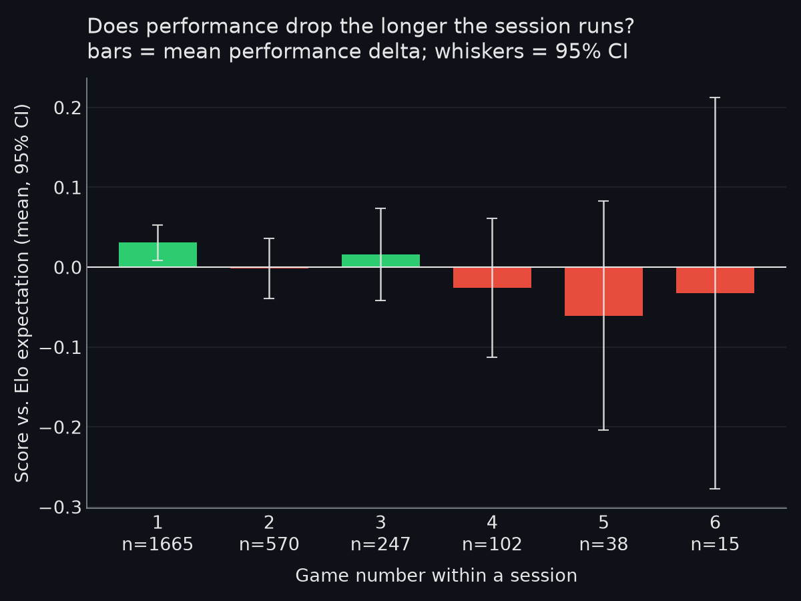
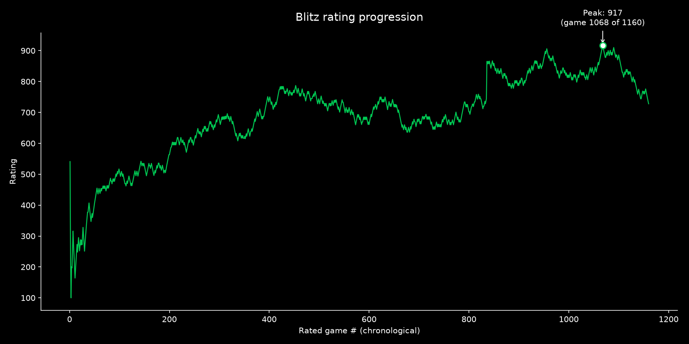
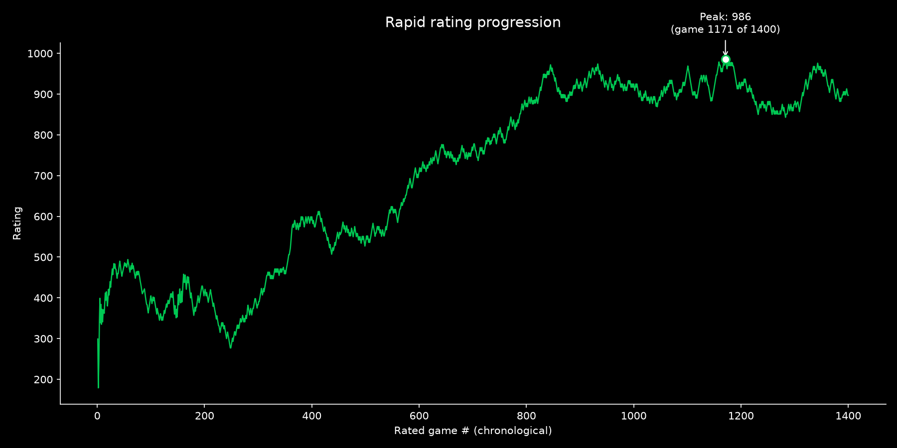

# chess-analytics

An automated analytics pipeline for a chess.com account. It pulls the
account's full game history from the public chess.com API, resolves opponent
countries, and produces win/draw/loss tables, rating-progression charts,
session-fatigue analysis and significance tests — refreshed daily via GitHub
Actions, which commits the updated data and charts back to the repo.

**Whose games?** The pipeline is username-agnostic: the account is set with the
`CHESS_USERNAME` variable. The data and charts in this repo are
produced for a friend's account (with their permission), not the maintainer's
own — treat the numbers below as that player's results. The dataset was reset
on 2026-10-24 when the original source account was renamed; history rebuilds
from scratch on the next run. Point it at any
account and it will rebuild everything from scratch on the first run.

Built by Mirza Ramis Baig.

The API: https://api.chess.com/pub/player/{username}/games/archives returns a list of monthly archive URLs, each returning full PGNs with clock times for clocked games.

<!-- STATS:START -->
### Last updated: 2026-10-25 11:42 UTC

**Dataset:** 2657 rated games, 2023-02-16 to 2026-10-25

**Statistically flagged countries this run** (Bonferroni-corrected within this run's test set —
does *not* correct across repeated daily runs; see notes in `chess_analytics/stats.py`):

_No country crosses the Bonferroni-corrected significance threshold this run — consistent with the earlier manual finding that country has no strong effect on this player's results once tested properly._

**Session fatigue** (does performance decline the longer the player stays in one sitting? —
sessions inferred from time gaps, see `chess_analytics/sessions.py`):

Based on 1666 inferred sessions, 2657 games. Position-vs-performance correlation: ρ=-0.0283, p=0.1464 — not distinguishable from no trend. First game of session vs. later games: later games score worse by 0.032 on average, p=0.0789 — not distinguishable from noise. _Both tests use α=0.05 uncorrected for this specific comparison — treat a single borderline p-value as a lead to watch over time, not a confirmed effect, same caveat as the country analysis._

**Peak rating** (see `chess_analytics/milestones.py` — this is a moving target, updates as new games are added):

- **Blitz**: peak rating **917**, reached after 1143 of 1244 rated games, on 2026-10-06 — the account has since come back down from it
- **Rapid**: peak rating **986**, reached after 1171 of 1397 rated games, on 2026-04-16 — the account has since come back down from it

**Charts:**

Full tables: [`data/country_outcome_tables.xlsx`](data/country_outcome_tables.xlsx) ·
Significance tests: [`data/significance_report.csv`](data/significance_report.csv) ·
Session fatigue data: [`data/session_fatigue_report.csv`](data/session_fatigue_report.csv) ·
Peak rating data: [`data/peak_rating_report.csv`](data/peak_rating_report.csv)
<!-- STATS:END -->

## Setup

1. In **Settings → Secrets and variables → Actions → Variables**, add:
   - `CHESS_USERNAME` = the chess.com username to analyse
   - `CHESS_CONTACT_EMAIL` = a real email (chess.com's API wants an
     identifying User-Agent; an anonymous/browser-spoofed one risks
     silent rate-limiting)
2. Confirm **Settings → Actions → General → Workflow permissions** is set to
   "Read and write permissions" — the workflow needs to commit files back.
3. Trigger it once manually (Actions tab → "Refresh chess.com stats" →
   "Run workflow") to do the initial full pull. This first run fetches the
   account's entire history and resolves every opponent, so expect it to take longer
   than subsequent runs — with 2,000+ opponents, budget several minutes.

## What runs on schedule

Daily at 06:17 UTC (see `.github/workflows/refresh_stats.yml`).

## Design notes / known limitations 

- **Incremental, not a full rebuild.** After the first run, only the
  current + previous month's games are re-fetched, and only opponents not
  already in `data/opponent_cache.json` get a fresh profile lookup. This
  keeps daily runs cheap.
- **`MIN_GAMES = 15`** in `chess_analytics/config.py` is the floor for any country to
  appear in tables/charts. Lowering it below 15 is not recommended — the
  per-country pool gets too small for the tests to mean anything.
- **Non-standard country codes** (`XX`, `XS`, `XO`, etc. — chess.com
  placeholders, not real ISO countries) are explicitly excluded, not
  guess-mapped. If chess.com introduces a new placeholder code previously
  unseen, it'll show up as `country_name = None` and silently drop out of the
  tables — if an expected country is missing, check `data/games.csv`.
- **Repeat-opponent games are flagged, not excluded from the raw dataset**
  (`is_repeat_opponent` column, threshold: played more than twice). This is
  a proxy for friendly matches: any opponent the account has played more
  than twice is treated as a friend and those games are excluded from the
  country tables.
- **Significance testing is automated but not fully "solved."**
  `build_significance_report()` runs a per-country t-test against
  baseline delta, with a Bonferroni correction sized to that day's number
  of eligible countries. What it can't do: correct across repeated daily
  runs. A country that flags once in 200 runs is noise; a country that
  flags repeatedly over weeks is worth a manual look.
- **Bullet and daily formats are excluded from charts** — too few games in
  this account's history to be meaningful. Easy to enable once there are
  enough.

## Files

- `main.py` — thin orchestrator, run as `python main.py`. Read this first —
  it's the whole pipeline in outline form; each step delegates to one module.
- `chess_analytics/config.py` — every path/threshold/constant, in one place
- `chess_analytics/fetch.py` — talks to the chess.com archives/games API
- `chess_analytics/cache.py` — opponent country resolution + on-disk cache
- `chess_analytics/transform.py` — merging, cleaning, all derived columns
  (outcome, rating_diff, is_repeat_opponent, performance_delta)
- `chess_analytics/stats.py` — the significance testing (t-tests, Bonferroni)
- `chess_analytics/report.py` — Excel tables, charts, README auto-update
- `data/games.csv` — full flattened game history, source of truth, grows over time
- `data/opponent_cache.json` — resolved opponent country/profile cache
- `data/country_outcome_tables.xlsx` — win/draw/loss tables, blitz + rapid
- `data/significance_report.csv` — raw per-country/format test output
- `charts/outcome_clustered_{blitz,rapid}.png` — clustered bar charts by country

**Why this is split this way:** nothing here is reused outside this one
pipeline and there's no test suite yet, so the split isn't buying reuse or
testability — it's purely so no single file becomes huge and each
one answers one question ("how do we fetch," "how do we cache," "how do we
decide what's significant") on its own.

## Methods, briefly

- **Country effect:** per-country t-test of performance delta against the
  overall baseline, Bonferroni-corrected across the countries tested that day
  (`stats.py`).
- **Session fatigue:** sessions inferred from time gaps between games
  (`sessions.py`); Spearman correlation of position-in-session vs.
  performance, plus first-game-vs-later-games comparison.
- **Peak rating:** tracked per format from the rating after each rated game
  (`milestones.py`).

